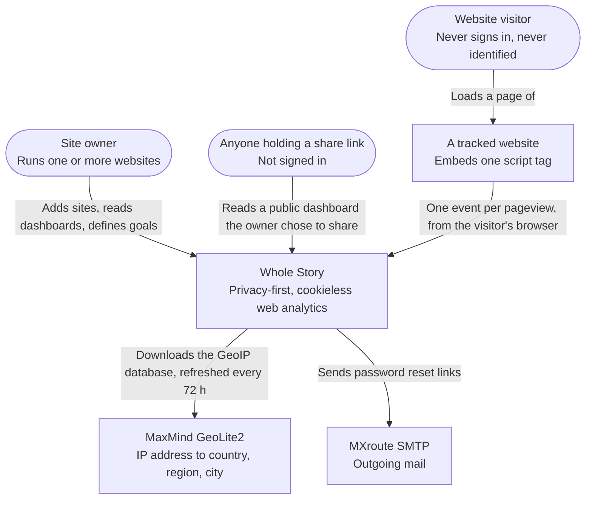
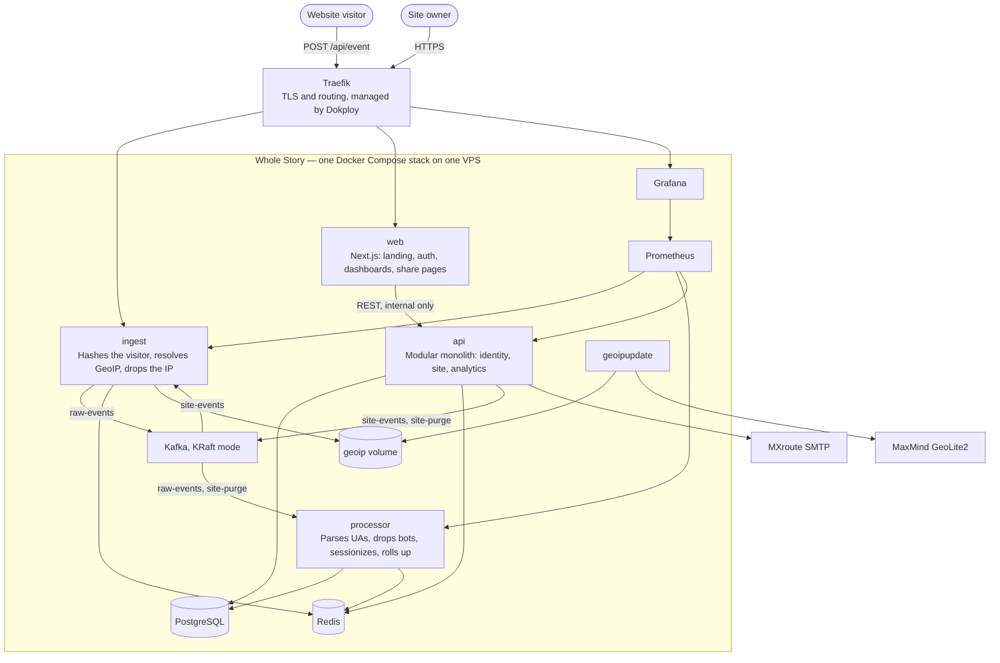
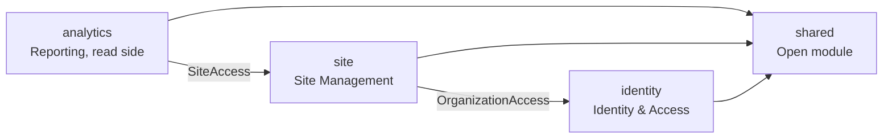
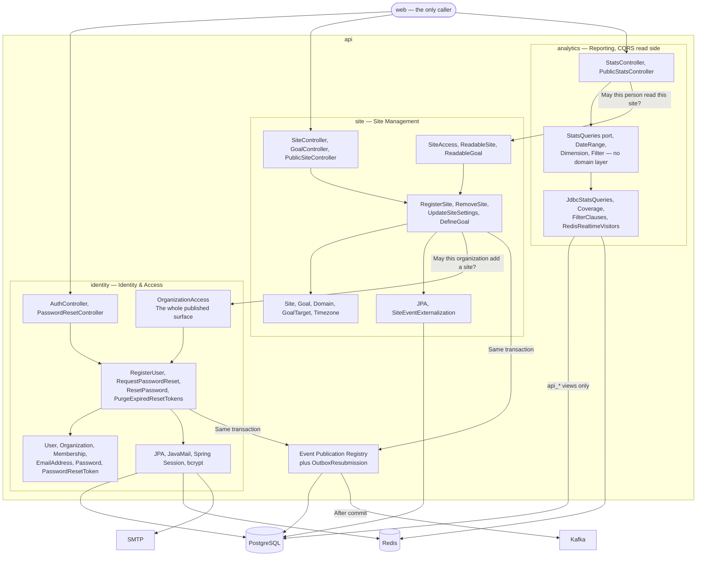

# Architecture

Three [C4](https://c4model.com) levels: the system in its surroundings, the containers it runs as, and the
components inside the one container whose internal boundaries are worth drawing.

There is no level 4. A class diagram is the code, and the code is in this repository; a drawing of it would
be a second copy that nothing keeps honest. Level 3 is drawn for `api` alone, because `api` is the only
container whose internal boundaries are enforced rather than implied — it is a modular monolith whose module
graph a test verifies on every build ([ADR 0002](../adr/0002-services-split-by-scaling-profile.md)). The
pipeline services are a sequence of steps, and a sequence is better written than drawn.

The diagrams are Mermaid rather than exported images, for three reasons: GitHub renders them with no tool to
install, they diff line by line so a change to one is reviewable, and a diagram that lives in the same file
as its explanation is one somebody will actually update. The cost is that elaborate layouts are impossible,
which is a constraint in the right direction.

## Level 1 — System context

Who uses Whole Story, and what it depends on outside itself.

The visitor is the person this product is about, and the arrow that matters is the one that is missing:
nothing travels from Whole Story back to their browser, and nothing is stored in it. They are not
recognisable across days either, because the hash that recognises them within one day is salted with a value
that rotates daily ([ADR 0005](../adr/0005-privacy-by-design.md)).

## Level 2 — Containers

What Whole Story is made of. Everything inside the box is one Docker Compose stack on one VPS managed by
Dokploy; the deployment itself is in [docs/deployment.md](../deployment.md).

Four things are worth reading off this diagram.

**The IP address appears once.** It reaches `ingest`, is used for the visitor hash and the GeoIP lookup, and
is dropped before anything is published — it is in no Kafka message, no log line and no table.

**Only three containers are reachable from the internet**: `web`, `ingest` and Grafana. `api` is not one of
them. The browser talks to Next.js, which calls `api` over the internal Docker network
([ADR 0011](../adr/0011-backend-for-frontend.md)), and the three services' metrics endpoints sit on separate
management ports that are never routed ([ADR 0024](../adr/0024-reading-the-metrics-the-services-record.md)).

**Both directions of the `ingest`–Kafka arrow are real, and they are different things.** `ingest` publishes
the events it accepts, and it *consumes* `site-events` to learn which domains it may accept at all. That
topic is log-compacted and read from the beginning at startup, so the allow-list rebuilds itself and no
operator maintains it ([ADR 0019](../adr/0019-telling-ingest-which-domains-are-tracked.md)).

**The split between PostgreSQL and Redis is not about speed.** Everything in Redis is derivable or
disposable: a lost salt costs one day of visitor continuity, lost session state restarts sessions, a lost
realtime set refills within minutes. Nothing a report is answered from lives there.

## Level 3 — Components inside `api`

`api` holds three bounded contexts in one deployable. Each is a Spring Modulith module, and `ModularityTest`
fails the build if one reaches into another's internals.

The module graph is a line with no cycle, and every arrow crosses a published interface rather than a
package:

`shared` is declared an open module, because a shared kernel reachable only through a facade would be a
layer and not a kernel. Keeping it open is only safe because it stays small and framework-free: identifiers
and the domain error types, nothing else.

Inside those modules:

`identity` and `site` have a domain layer and it is pure Java — no Spring, no JPA, no Jackson, enforced by
`DomainPurityTest` ([ADR 0010](../adr/0010-pure-domain-layer.md)). `analytics` has none, deliberately: it is
the read side, it owns no aggregate and protects no invariant, so a domain model there would be ceremony
([ADR 0001](../adr/0001-selective-domain-driven-design.md)). That is also why it reads PostgreSQL through
`analytics.api_*` views and never the tables — the schema belongs to `processor`, and the views are the
contract between the two services ([ADR 0003](../adr/0003-schema-ownership-and-database-roles.md)).

Three details on this diagram are the answers to questions that came up while building it.

**`SiteAccess` returns authorization and the site's settings together.** Reporting needs the timezone for
every query, because a day starts where the site says it does; asking twice would be two round trips and a
window in which the two answers disagree.

**`OrganizationAccess.allowsAnotherSite` takes the current site count as an argument.** Identity owns the
limit but must not read another context's tables, and a caller that fetched the limit and compared it itself
would have taken the rule with it.

**Everything leaving `api` leaves through the outbox, and the arrow through PostgreSQL is the point.** A
domain event is written to `platform.event_publication` in the same transaction as the aggregate, and only
after that commit does anything go to Kafka or SMTP. That is what makes "the site was registered" and
"ingest was told" unable to disagree ([ADR 0009](../adr/0009-transactional-outbox-with-spring-modulith.md)).

## What these diagrams do not show

- **How an event actually travels**, step by step, and what is rejected or dropped where:
  [ADR 0005](../adr/0005-privacy-by-design.md),
  [ADR 0006](../adr/0006-idempotent-at-least-once-processing.md) and
  [ADR 0016](../adr/0016-ingest-admission-control.md).
- **The tables, and which metric is answered from which one**:
  [ADR 0007](../adr/0007-events-sessions-and-additive-rollups.md).
- **What any of it costs.** Measured numbers, the method, and two measurements that turned out to be
  measuring the measuring: [docs/performance.md](../performance.md).
- **Why each of these boxes exists.** Every one is the subject of an ADR, and the alternatives that were
  considered and rejected are in there too: [docs/adr](../adr/README.md).
